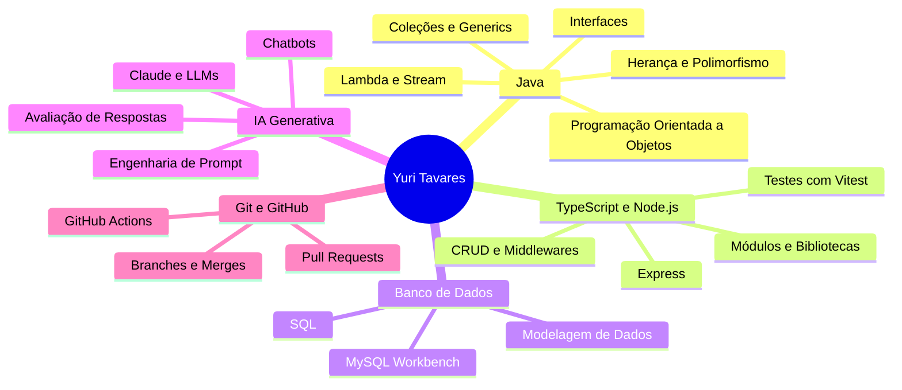
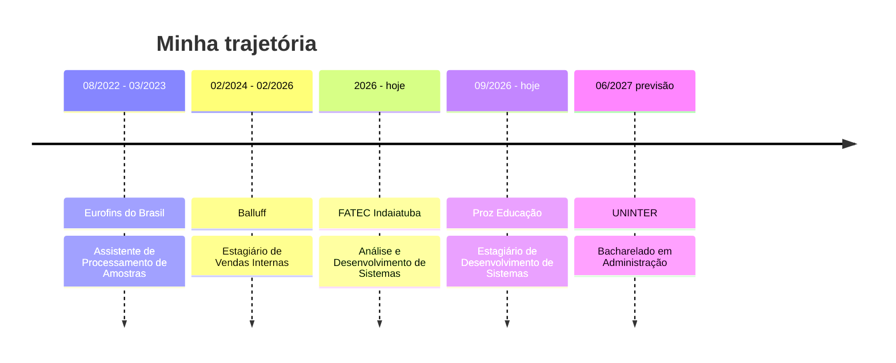
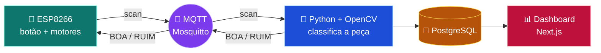

<!-- ======================= CABEÇALHO ======================= -->

 

  

  

<!-- MENU DE NAVEGAÇÃO (clique para pular entre as seções) -->
<a href="#sobre"><kbd> 👨‍💻 Sobre </kbd></a>
<a href="#stack"><kbd> 🛠️ Stack </kbd></a>
<a href="#aprendizado"><kbd> 📚 Aprendendo </kbd></a>
<a href="#experiencia"><kbd> 💼 Experiência </kbd></a>
<a href="#projetos"><kbd> 🚀 Projetos </kbd></a>
<a href="#formacao"><kbd> 🎓 Formação </kbd></a>
<a href="#stats"><kbd> 📊 Stats </kbd></a>
<a href="#contato"><kbd> 📬 Contato </kbd></a>

 

<!-- ======================= SOBRE ======================= -->

## 👨‍💻 Sobre mim

Sou estudante de **Análise e Desenvolvimento de Sistemas na FATEC Indaiatuba** e **estagiário de Desenvolvimento de Sistemas na Proz Educação**, onde trabalho em um projeto de **IA Generativa**: um chatbot para apoiar o time de vendas no contato com leads.

Minha trajetória em **multinacionais** (Balluff e Eurofins) me deu uma visão prática de processos de negócio, de sistemas como **SAP** e **LIMS** e de como a tecnologia ajuda a operação a render mais. Hoje uso essa bagagem para construir software com mais contexto e propósito.

| | |
|:--|:--|
| 🎯 **Foco** | Engenharia de Software e Desenvolvimento **Backend** |
| 🌱 **Também curto** | Frontend, Inteligência Artificial e Computação em Nuvem |
| 🔭 **Estudando agora** | Java com POO, TypeScript + Node.js, SQL e IA Generativa |
| 💼 **Trabalhando em** | Chatbot de vendas com IA (Claude + Engenharia de Prompt) |
| 🎓 **Cursando** | ADS na FATEC Indaiatuba e Administração na UNINTER |
| 🤝 **Aberto a** | Oportunidades e conexões em Desenvolvimento de Software |

<b>💡 Clique para ver o que me move</b>

 

- ⚙️ Usar tecnologia para **otimizar processos** e **automatizar atividades**
- 🧱 Construir uma base sólida em **Java, orientação a objetos e backend**
- 🤖 Explorar como a **IA generativa** gera valor real para o negócio
- 📈 Aprender de forma contínua e transformar estudo em **projetos práticos**

 

<!-- ======================= STACK ======================= -->

## 🛠️ Stack e tecnologias

**Linguagens e backend**

**Frontend**

**Banco de dados**

**Ferramentas, versionamento e nuvem**

**IA, negócios e dados**

 

<!-- ======================= EM APRENDIZADO ======================= -->

##  Em aprendizado

 

<!-- ======================= EXPERIÊNCIA ======================= -->

## 💼 Experiência

<b>🤖 Proz Educação · Estagiário de Desenvolvimento de Sistemas</b> &nbsp;·&nbsp; <code>09/2026 – atual</code>

 

Projeto de **IA Generativa** para um chatbot conversacional que apoia a equipe de vendas no contato com leads.

- Desenvolvimento e melhoria contínua de uma **skill de IA com Claude**, com **Engenharia de Prompt** para orientar o comportamento do modelo
- Uso de dados do **RD Station CRM** e do **RD Station Conversas** nas interações comerciais assistidas por IA
- Registro de históricos e métricas em **JSON e Markdown** para análises de desempenho
- Análise das conversas para achar erros, avaliar a qualidade das respostas e refinar as instruções da IA
- Versionamento com **GitHub**: Pull Requests revisados e aprovados antes da integração
- **GitHub Actions** no fluxo de atualização e disponibilização da solução

`Claude` `Engenharia de Prompt` `RD Station` `JSON` `Markdown` `GitHub` `GitHub Actions`

<b>🏭 Balluff Controles Elétricos · Estagiário de Vendas Internas</b> &nbsp;·&nbsp; <code>02/2024 – 02/2026</code>

 

- Lançamento de pedidos no **SAP SD** e criação e gestão de leads no **SAP CRM**
- Extração, análise e processamento de pedidos e cotações a partir de portais de clientes
- Cadastro de clientes, processamento de pré-pedidos e apoio ao fluxo de vendas
- Atualização de planilhas de acompanhamento, melhorando a precisão dos dados
- Organização de documentos internos e apoio ao onboarding de novos colaboradores
- Suporte administrativo às equipes de vendas, logística e back-office

`SAP SD` `SAP CRM` `ERP` `Excel`

<b>🔬 EdBr – Eurofins do Brasil · Assistente de Processamento de Amostras (temporário)</b> &nbsp;·&nbsp; <code>08/2022 – 03/2023</code>

 

- Recebimento, pré-triagem e triagem de amostras, com rastreamento no sistema **LIMS**
- Monitoramento do **TAT (Turnaround Time)** e gestão de prazos (lead times)
- Envio de amostras para unidades nacionais e internacionais
- Controle de qualidade, gestão de estoque (importação e exportação) e revisão de notas fiscais
- Comunicação com líderes e equipes multifuncionais em diferentes localidades
- Organização do ambiente seguindo os princípios do **5S**

`LIMS` `5S` `Logística` `Qualidade`

 

<!-- ======================= PROJETOS ======================= -->

## 🚀 Projetos em destaque

 

| Projeto | O que faz | Tecnologias |
|:--|:--|:--|
| 💸 [**controle-de-gastos**](https://github.com/yuritavaresx/controle-de-gastos) | Módulo que registra despesas do mês e gera relatório por categoria. Feito com **TDD** (testes antes do código) e com **registro de uso de IA** em cada função. Projeto de Linguagem de Programação I (FATEC) | `TypeScript` `Node.js` `Vitest` `tsx` |
| ☕ [**curso-java-orientacao-objeto**](https://github.com/yuritavaresx/curso-java-orientacao-objeto) | Estudos, exercícios e desafios do curso **Java e POO** (17 capítulos, de fundamentos até Lambda e Stream), organizados por capítulo | `Java` `IntelliJ IDEA` `Git` |
| 🔀 [**curso-git-github**](https://github.com/yuritavaresx/curso-git-github) | Desafios do curso de **Git e GitHub**: commits, histórico, resolução de conflitos, branches, merges, Pull Requests e Forks | `Git` `GitHub` `Git Bash` `VS Code` |
| 🏭 [**OEE-Arduino**](https://github.com/Pira4Ever/OEE-Arduino) | Projeto Integrador da FATEC em equipe: esteira com **visão computacional** que classifica peças e calcula indicadores de **OEE**, com dashboard online | `ESP8266` `Python` `OpenCV` `MQTT` `PostgreSQL` `Next.js` |
| 🤖 **Chatbot de vendas com IA** | Projeto profissional na Proz: skill de IA com Claude que apoia o time de vendas no atendimento a leads | `Claude` `RD Station` `GitHub Actions` |

 

### 🏗️ Arquitetura do OEE-Arduino

 

<!-- ======================= FORMAÇÃO ======================= -->

## 🎓 Formação e certificações

<b>📜 Ver todos os cursos e certificados</b>

 

**☁️ Cloud e infraestrutura**

- Arquitetura Azure — **Microsoft**
- Infraestrutura Global da AWS: Regions, Availability Zones e VPC — **Amazon AWS**
- CloudFormation / Infrastructure as Code — **Amazon AWS**
- Bancos de Dados Gerenciados e Migração/DMS — **Amazon AWS**
- Stack de Analytics na AWS e oportunidades da área — **Amazon AWS**

**📊 Dados**

- Analyzing and Visualizing Data with Microsoft Power BI — **Fundação Bradesco**
- Excel Básico — **Fundação Bradesco**

**💼 Tecnologia e negócios**

- ERPs — **FATEC**
- Projeto Propósito — **FATEC**
- A Transformação Digital do Agro — **John Deere**
- Inteligência Artificial em Serviços Financeiros — **Topaz**

**🔧 Versionamento**

- Git e GitHub

 

### 🧠 Competências

| 🧩 Técnicas e analíticas | 🤝 Interpessoais |
|:--|:--|
| Pensamento analítico | Comunicação clara e profissional |
| Resolução de problemas | Trabalho em equipe e colaboração |
| Análise e documentação de processos | Adaptabilidade |
| Atenção aos detalhes | Proatividade |
| Organização e gestão de tempo | Aprendizado contínuo |

 

## 🌎 Idiomas

| Idioma | Nível | |
|:--|:--|:--|
| 🇧🇷 Português | Nativo | ●●●●● |
| 🇺🇸 Inglês | Intermediário (B2) | ●●●○○ |
| 🇪🇸 Espanhol | Básico | ●○○○○ |

 

<!-- ======================= ESTATÍSTICAS ======================= -->

## 📊 Estatísticas do GitHub

 

<!-- ======================= CONTATO ======================= -->

## 📬 Vamos conversar?

Estou aberto a oportunidades, trocas de conhecimento e novas conexões na área de desenvolvimento de software.

 

⭐ Obrigado por visitar meu perfil! &nbsp;·&nbsp; <a href="#">⬆️ Voltar ao topo</a>

